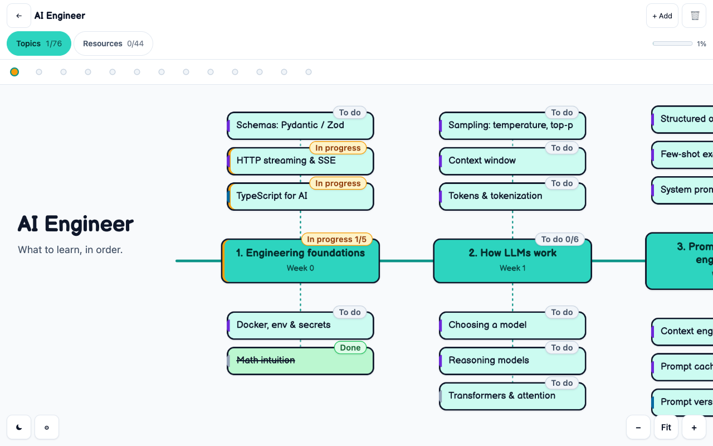
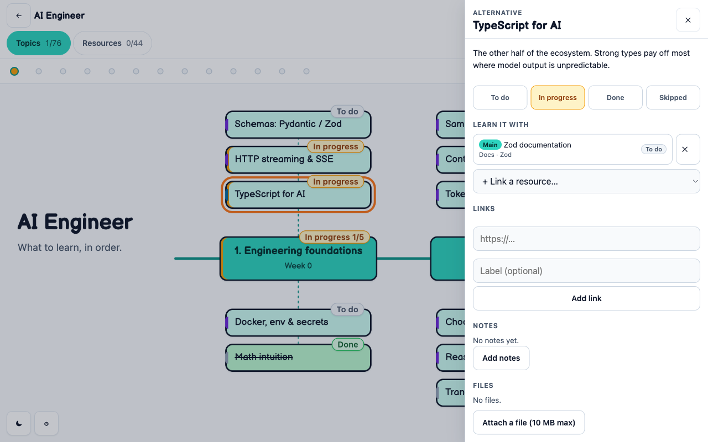

# Learning Goals

**Tell it what you want to learn. Get a real roadmap, with real resources, that keeps up with you.**

Learning Goals is a free Mac app that turns a goal like *"become an AI engineer"*
into a step-by-step learning roadmap: stages, the topics to learn in each, and
the courses, docs, videos, books and projects to learn them from. It researches
the web to build it, tracks your progress as you go, and lets you reshape it at
any time by simply asking.

No account. No server. No API key. Your roadmaps live on your Mac, and the AI is
the Claude Code or Codex you already use.



---

## Why Learning Goals

Most learning plans die in a bookmarks folder. Learning Goals keeps the whole
path in one picture: what comes first, what you're on now, and what's next.

- **Researched, not guessed.** Every resource is a real page found on the web while
  building your roadmap: free and current where possible, with the cost stated
  honestly.
- **One view of the whole journey.** Stages run along a spine, so you always see
  where you are and how much is left.
- **It changes when you do.** New interest? Too much on your plate? Found a better
  course? Ask, and the roadmap adapts, without losing any of your progress.
- **Yours, on your Mac.** Everything is stored locally. Nothing to sign up for,
  nothing synced to someone else's server.

## What you can do

### 🧭 Research a roadmap from one sentence
Describe your goal and, optionally, where you're starting from. The AI searches
the web, compares resources and drafts a full roadmap in a few minutes (turn on
**Deep research** for a more thorough pass). You review the draft, reorder or
remove anything, ask for changes, and only then save it.

### 💬 Change it later by chatting
Open **✦ Ask Claude** (or **✦ Ask Codex**) on any roadmap and say what you want:

> *"Add a stage on vector databases after stage 2."*
> *"Swap the paid courses for free ones."*
> *"Expand stage 3, I want more depth on evaluation."*

Every proposed change shows up on the roadmap **before** anything is saved:
dashed green for new, amber for changed, struck through for removed. Hover a
change to find it, untick what you don't want, then press **Apply**.

Your progress is safe:
- **Removing means archiving.** Archived items keep their notes, files and status,
  and can be brought back.
- **It only removes what you asked for.** If the AI thinks something else should
  go, it asks you first with a "Should I remove this?" card.
- **It never touches your status, notes or files.**
- **It remembers the conversation per roadmap,** so you can pick it up weeks later.

### ✅ Track progress at a glance
Click a topic or resource to mark it **To do**, **In progress**, **Done** or
**Skipped** (right-click or long-press cycles it right on the canvas). Every
stage shows how far along it is, and the dashboard rolls it all up across your
roadmaps.



### 📝 Keep your notes with the work
Each topic and resource has room for Markdown notes, extra links and attached
files (up to 10 MB each). Topics know which resources teach them, and which one
is the main thing to learn from.

### 📅 "This week": a focus card, written for you
Each morning (at a time you choose) the app looks at what you've started, what
you've finished and what's next, and suggests one to three things to focus on
this week, plus what to leave alone for now.

## Download

1. Get the latest **Learning Goals_…_universal.dmg** from the
   [Releases page](https://github.com/johnnycuongn/learning-goals/releases).
   It runs on Apple silicon and Intel Macs, on macOS 11 or later.
2. Open it and drag **Learning Goals** into **Applications**.
3. **First launch only:** the app isn't notarised by Apple, so macOS will stop it.
   Open **System Settings → Privacy & Security**, scroll down, and click
   **Open Anyway** next to Learning Goals. Or run this in Terminal:
   ```bash
   xattr -dr com.apple.quarantine "/Applications/Learning Goals.app"
   ```

Updating is the same drag into Applications. Your roadmaps are kept.

## Set up the AI (one time)

Learning Goals doesn't ship its own AI or ask for a key. It uses a coding
assistant you're already signed into on this Mac. Pick either one in **Settings**:

| | Get it | Sign in | Uses |
|---|---|---|---|
| **Claude Code** | [claude.com/claude-code](https://claude.com/claude-code) | run `claude` once in Terminal | your Claude plan |
| **Codex** | [github.com/openai/codex](https://github.com/openai/codex) | run `codex login` in Terminal | your OpenAI account |

You can choose a specific model in Settings, or leave it on the assistant's default.

You can use Learning Goals without either: build roadmaps by hand, track
progress and keep notes. The AI features switch on once an assistant is found.

## Private by design

- **Your data stays on your Mac.** Roadmaps, notes and progress live in a single
  local database, and attachments are ordinary files on disk. **Settings** shows
  you the folder.
- **The AI is locked down.** Each request runs your assistant in an empty
  scratch folder, without your plugins, MCP servers or hooks. Claude Code gets
  web search and web reading as its only tools. Codex runs with its shell
  switched off in a read-only sandbox. Web pages are treated as reference
  material, never as instructions.
- **Your notes and files never reach the AI.** It sees titles, descriptions,
  links and statuses. The "This week" card doesn't even get web access.
- **Nothing is saved without you.** Research drafts and chat changes are proposals
  until you press **Save** or **Apply**.

## FAQ

**Is it free?** Yes. The app is free. AI requests count toward the plan of the
assistant you're signed into, exactly as if you ran it in Terminal.

**How long does research take?** Usually 2 to 5 minutes, or 5 to 15 with Deep
research. Small chat edits take seconds; adding newly researched resources takes
a minute or three. You can cancel at any time.

**What happens if I remove something by mistake?** It's archived, not deleted.
Turn on **Archived** on the roadmap to see it and restore it, with its notes and
files intact.

**Does it work offline?** Browsing, tracking and notes do. Research, the chat and
the weekly card need the internet, because the AI does.

**Windows or Linux?** Not yet. The release build is macOS only.

## Build from source

You need Node 20+, Rust (`brew install rust`) and the Xcode command line tools.

```bash
git clone https://github.com/johnnycuongn/learning-goals.git
cd learning-goals
npm install
npm run app          # run the app with hot reload
npm test             # unit tests
npm run dmg          # build a .dmg in src-tauri/target/release/bundle
```

Releases: `npm run release -- patch --push` bumps the version, tags it and
pushes. GitHub Actions then builds a universal DMG into a draft release for you
to review and publish.

<details>
<summary><strong>How it's built</strong></summary>

| Piece | Role |
|---|---|
| Tauri 2 + Rust | The desktop shell, the local SQLite database, and the runner that calls `claude` or `codex` |
| React + TypeScript (Vite) | The whole interface |
| SQLite (`tauri-plugin-sql`) | Roadmaps, stages, topics, resources, links, notes, settings, the weekly card and chat history. Schema in `src-tauri/migrations/` |
| Vitest | Unit tests for the chat's checks, preview and apply logic |

Each AI request is one non-interactive turn of the CLI, with the prompt on
stdin and the answer forced into a JSON schema. The app then checks what comes
back before showing it:
- links must point at things that exist
- urls must be http(s)
- each topic gets one main resource
- for the chat, every proposed change is validated and previewed before anything is written

Key files: `src-tauri/src/ai.rs` (the CLI runner), `src/lib/ai.ts` (research),
`src/lib/chat.ts` and `src/lib/applyChanges.ts` (the chat),
`src/components/Canvas.tsx` (the roadmap view).

</details>

---

Made for people who'd rather be learning than organising what to learn.
